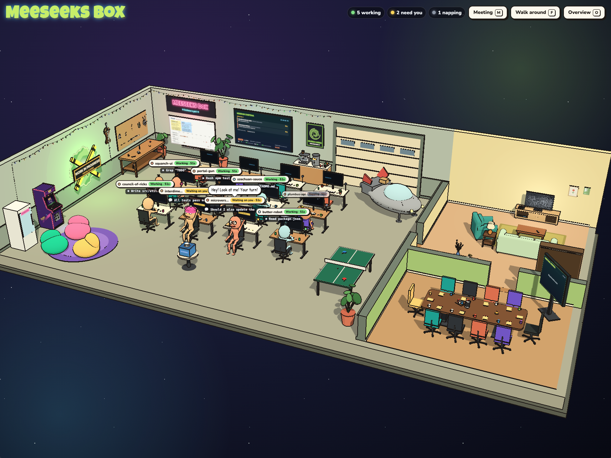
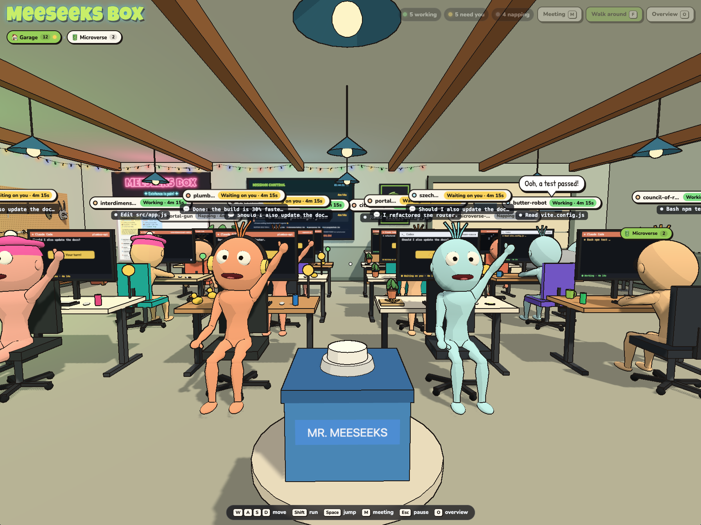
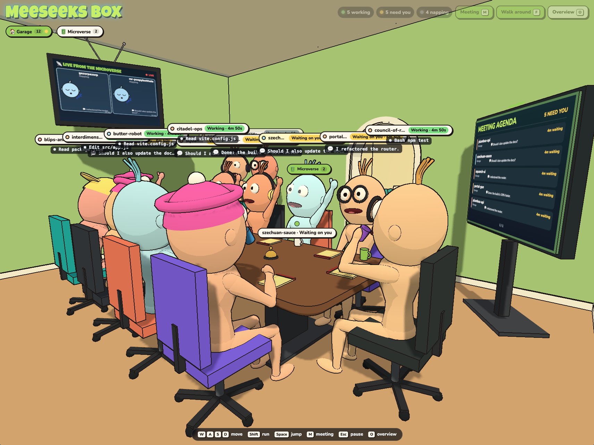
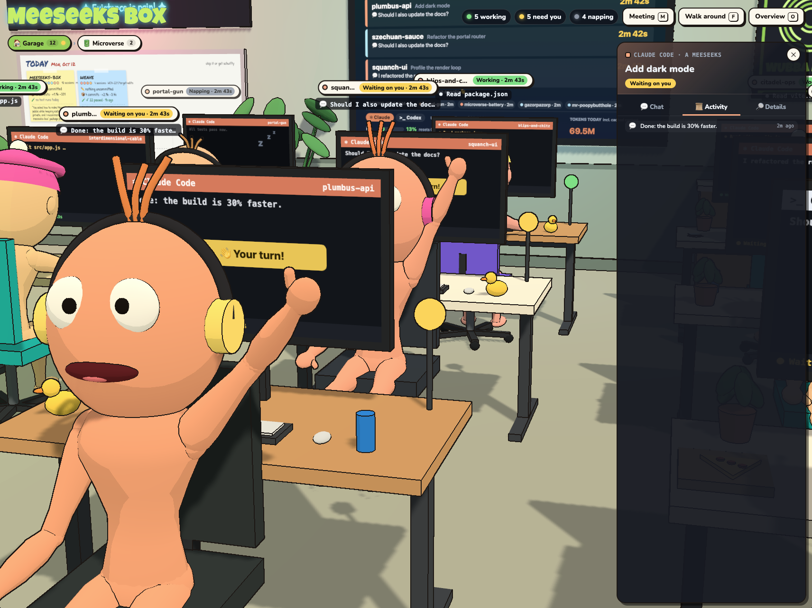
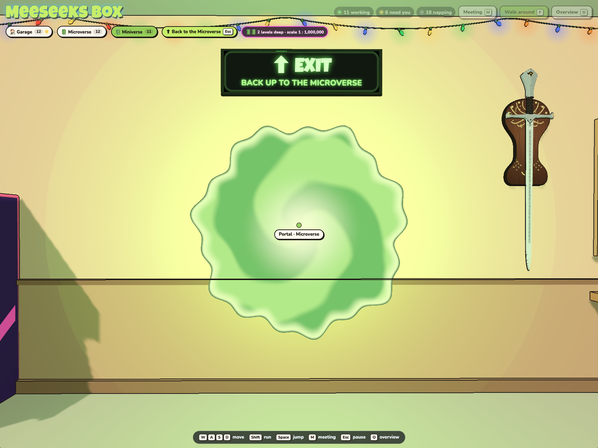
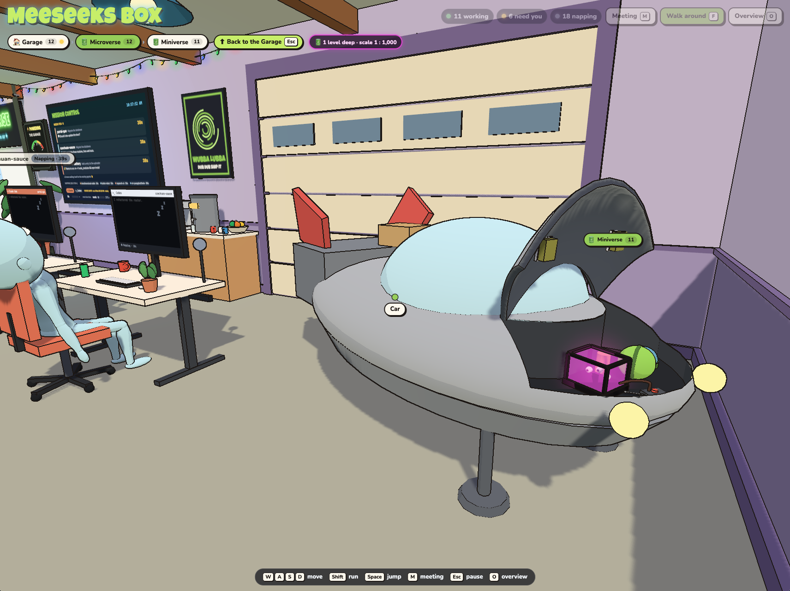
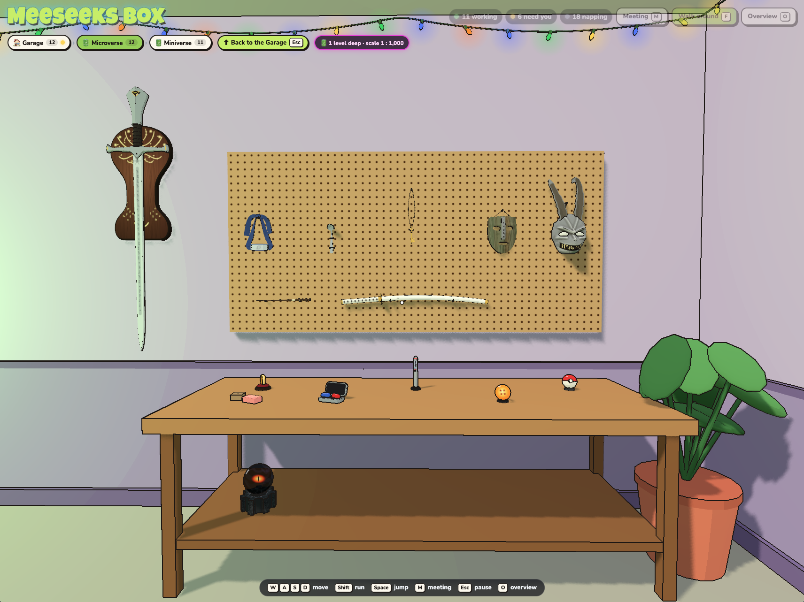
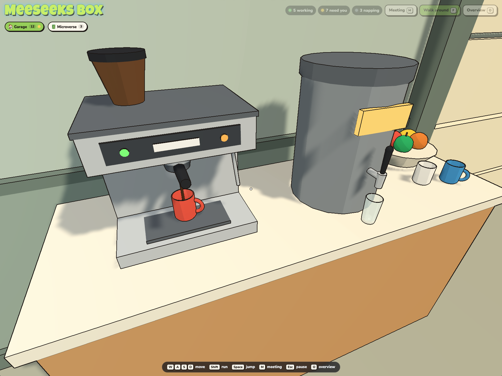
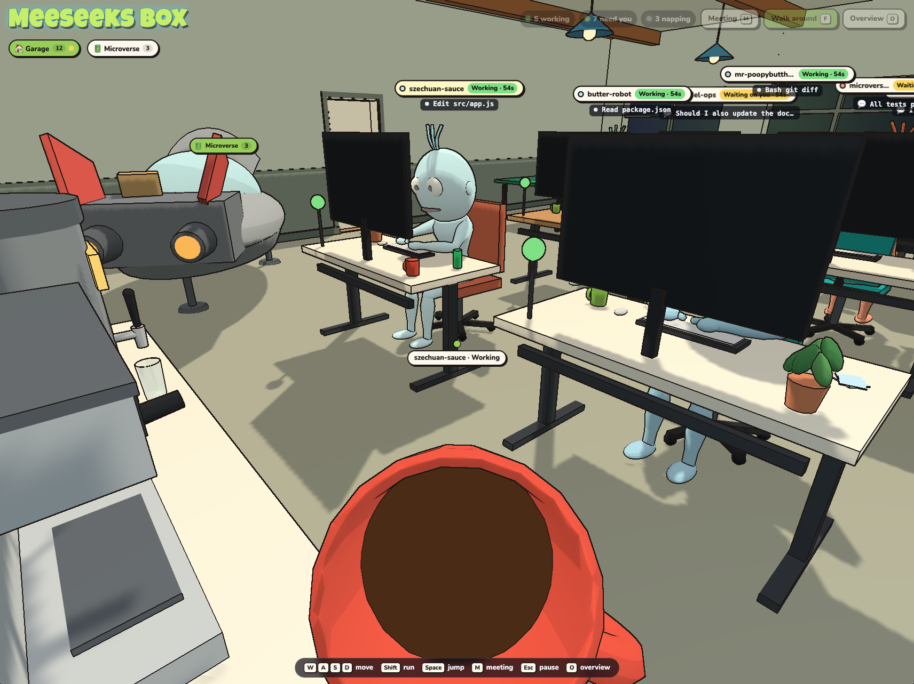
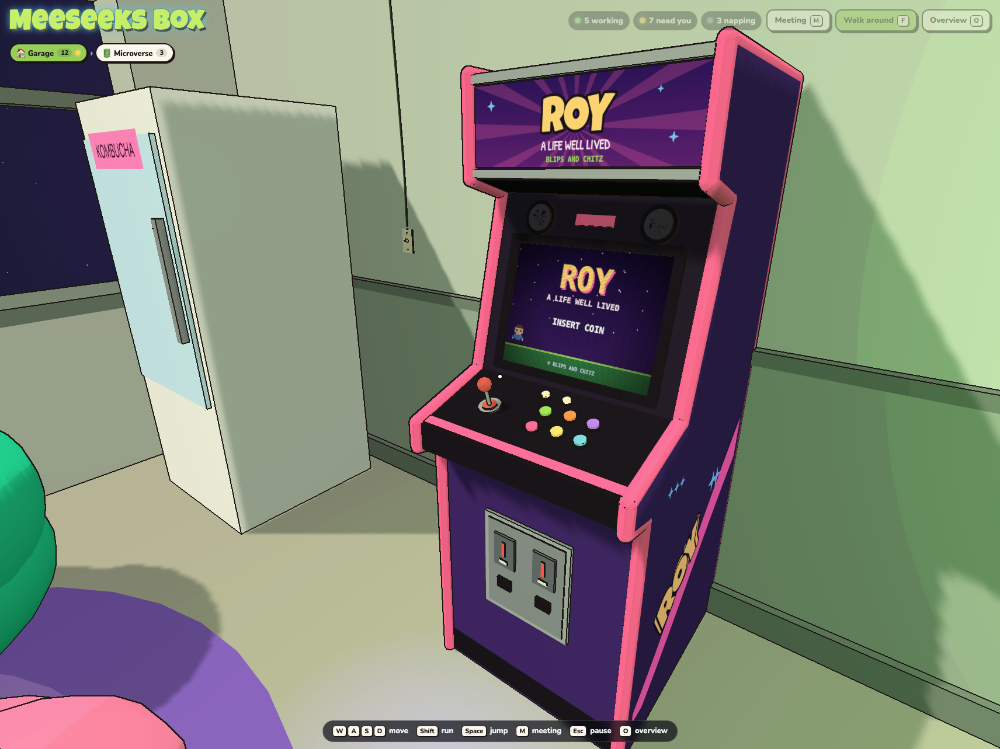

# Meeseeks Box

A cartoon 3D office for your Claude Code and Codex sessions. Running agents appear at desks, with their activity and status reflected in the scene. Click one to inspect its conversation and resume command. You can also summon a Claude Code agent from the box, choose a project folder, and give it a task.



## What You Can Do

- Watch your running sessions appear as Meeseeks, with their activity and status reflected in the office.
- Click an agent to read its conversation and activity, or copy a command to resume the session.
- Press the box to summon a Claude Code agent, choose a project folder, and give it a task.
- Walk around, call everyone to a meeting, and explore the other spaces.

You can send prompts and answer permission requests in the office for Claude Code agents summoned from the box or started with `claude-box` (see [Quick Start](#quick-start)). Other Claude Code and Codex sessions can be viewed in the office.

## The Virtual Office

<table>
  <tr>
    <td><strong>Walk around</strong><br><a href="docs/images/office.png"></a></td>
    <td><strong>Join a meeting</strong><br><a href="docs/images/meeting.png"></a></td>
    <td><strong>Inspect a session</strong><br><a href="docs/images/session.png"></a></td>
  </tr>
  <tr>
    <td><strong>Take the portal</strong><br><a href="docs/images/portal.png"></a></td>
    <td><strong>Explore the microverse</strong><br><a href="docs/images/car_multiverse.png"></a></td>
    <td><strong>Explore the collection</strong><br><a href="docs/images/collection.png"></a></td>
  </tr>
  <tr>
    <td><strong>Enjoy drinks and fruits</strong><br><a href="docs/images/coffee.png"></a></td>
    <td><strong>Have a break</strong><br><a href="docs/images/drink.png"></a></td>
    <td><strong>Visit the arcade</strong><br><a href="docs/images/roy_arcade_machine.png"></a></td>
  </tr>
</table>

## Quick Start

Requires Node.js 20.19+ (or 22.12+) on macOS or Linux.

```bash
npx @j4nn0/meeseeks-box
```

The office opens in your browser and finds sessions in `~/.claude` and `~/.codex` automatically. Add `--no-open` to skip opening the browser, or set `PORT` to use a port other than 5199.

To interact with a Claude Code session started outside the box, run `npx -p @j4nn0/meeseeks-box claude-box` instead of `claude`. It accepts the same arguments.

### From source

```bash
git clone https://github.com/J4NN0/meeseeks-box.git
cd meeseeks-box
npm install
npm run dev
```

Open the local URL printed by Vite (normally `http://127.0.0.1:5199`). In a clone, run `./bin/claude-box` instead of `claude`. For a built version or simulation instructions, see [Development](docs/development.md).

## How it works

The office runs locally and reads your Claude Code and Codex sessions. Session activity can include conversation excerpts, so the server is available only on your computer by default. Tasks and decisions you send to a Claude Code agent can change files in the project you choose.

## Roadmap

- [ ] Interdimensional cable
- [ ] Arcade game
- [ ] More portal destinations
- [ ] Meeseeks wardrobe

## License

[GPL-3.0](LICENSE)
